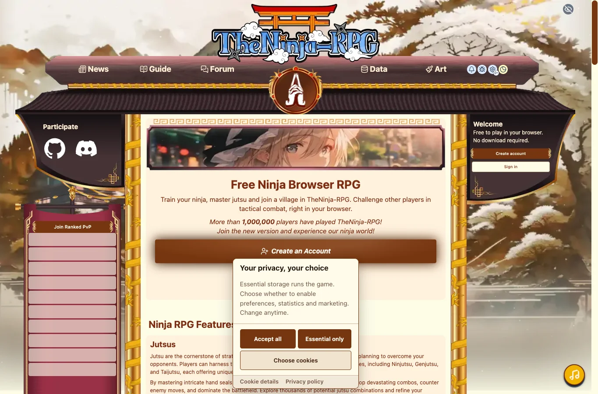
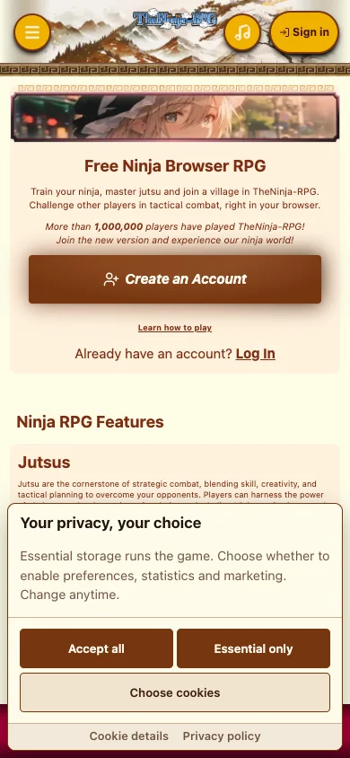
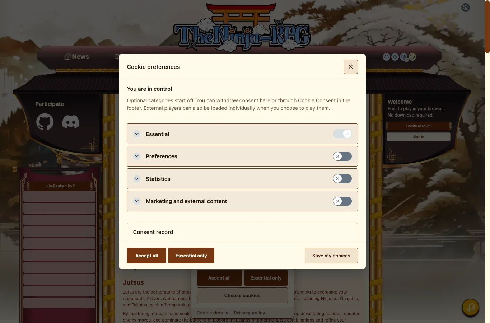
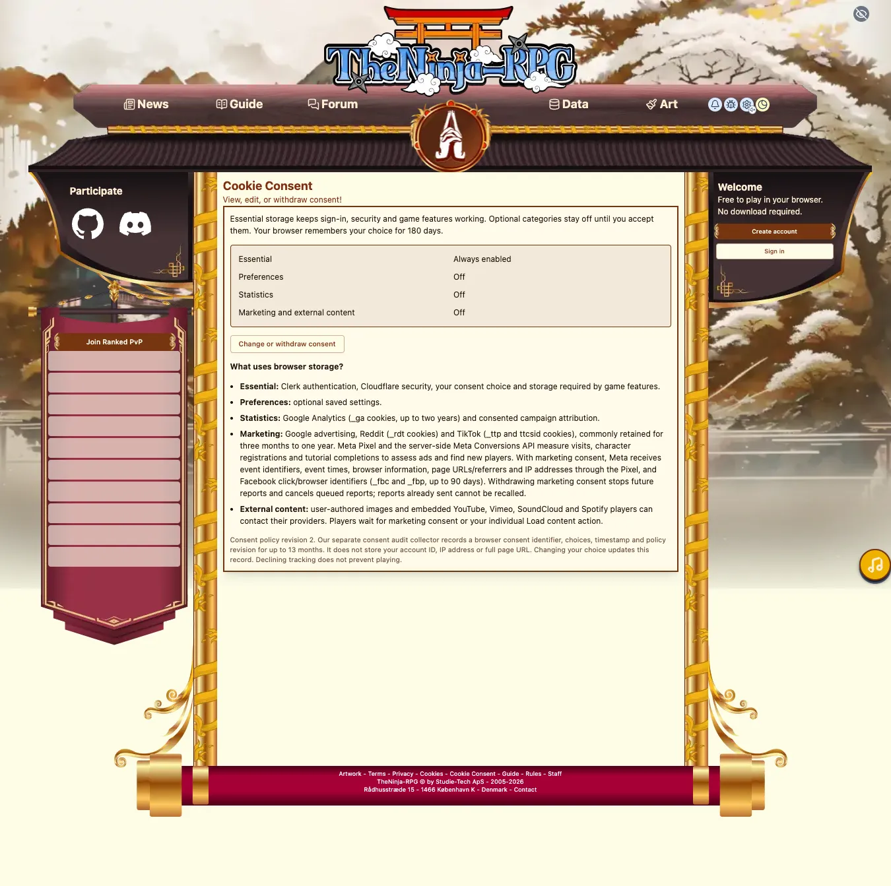

# Consent integration

The application bundles MIT-licensed vanilla-cookieconsent. Optional categories
start denied. Users can review or withdraw choices from the consent page.
Withdrawal reloads the document to stop integrations already running.

## Receipt collection

Configure the server-only `CONSENT_RECEIPTS_URL` with the HTTPS receipt endpoint
before deploying. The browser posts to `/api/consent-receipts`. The server validates the minimal
receipt and forwards only its JSON and Origin. Cookies, authorization, IP forwarding
headers, and referrers are never forwarded. Do not put the destination in a
`NEXT_PUBLIC_` variable.

The collector must accept POST requests with the production Origin and a minimal
JSON receipt: `consentId`, `revision`, `categories`, `consentTimestamp`, and
`language`. It must support idempotent redelivery and return a successful status
only after recording the receipt. The proxy forwards only receipt requests; the
collector must not expose administration or record-reading routes on this path.

Missing configuration or an unavailable collector leaves the latest receipt queued
for retry on a later visit or when the connection returns. Consent choices and
tracker gating apply independently of collection availability. Verify the proxy,
persistence, and withdrawal behavior on a preview before production rollout.

## Interface

